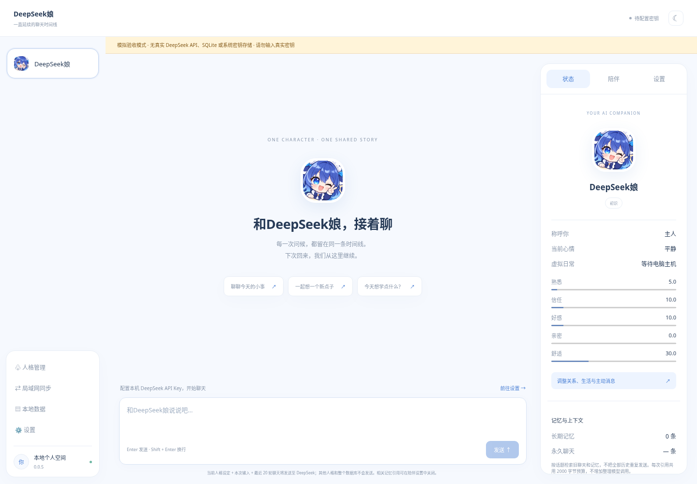
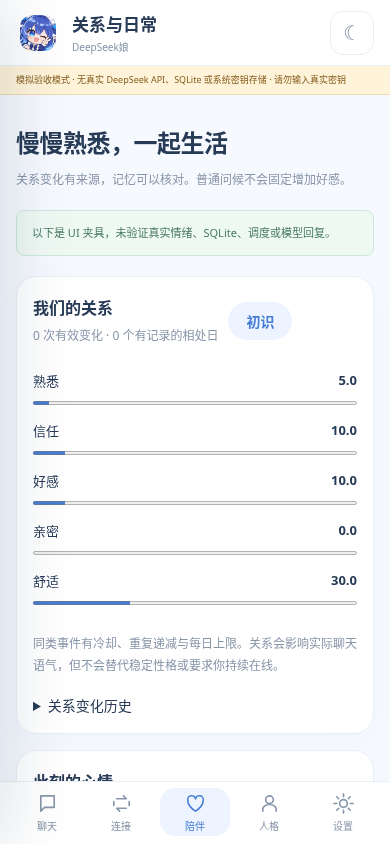

# DeepSeek娘 · DeepSeek-Niang

一款面向 Windows 与 Android 的本地优先 AI 陪伴软件，让不同人格拥有各自延续的聊天、记忆与虚拟日常。

**[下载 Windows 版](https://github.com/Lyuu508/DeepSeek-Niang/releases/download/v0.0.8/DeepSeek-Niang_0.0.8_windows-x64-setup.exe) · [下载 Android 版](https://github.com/Lyuu508/DeepSeek-Niang/releases/download/v0.0.8/DeepSeek-Niang_0.0.8_android-arm64-isolated-test.apk) · [首次使用](docs/USAGE.md)**

当前版本为 **v0.0.8 测试版**。已有自动化测试和原生构建记录，真实设备、家庭网络及真实 API 体验待验收。

v0.0.6 的桌宠已整合到 Windows 主客户端。透明角色能在桌面上自动走动，也支持直接拖动、点击挥手和双击聊天。[使用与验收](docs/phases/05-desktop-pet.md) · [dsh-pet 动画署名](apps/companion/src/desktop-pet/media/NOTICE.md)

Windows 侧栏「视频中心」支持用户授权的本地视频分析，需要本机 FFmpeg、Ollama/Qwen3-VL。带音轨时使用本机 Whisper。[视频中心准备与使用](docs/phases/06-video-understanding.md)

两端可从聊天中使用本机朗读和语音输入。在「设置 → 语音与麦克风」为当前人格选择音色，或试听原创元音唱段。[语音试用与设备要求](docs/phases/07-voice-singing.md)

## 让聊天慢慢积累

每个人格都有独立的聊天时间线，不必为了继续聊天反复新建会话。你可以调整名字、性格与称呼，管理重要记忆，查看关系、情绪和虚拟生活记录。

- **独立人格**：聊天、记忆、关系和日常按人格区分。
- **本地保存**：历史记录保存在设备上，不依赖云数据库或 NAS。
- **电脑与手机衔接**：通过局域网扫码配对，同步允许共享的记录。
- **可控的主动交流**：自行选择频率、安静时段，以及是否允许模型生成分享。

聊天使用你自己的 DeepSeek API Key，需要联网并承担相应 API 费用。本地优先不代表离线模型；聊天及允许引用的相关资料会发送至 DeepSeek。

## 界面预览

以下是 v0.0.5 的浏览器 UI 测试截图，仅展示界面布局。其中的关系数值和状态是测试数据，不代表真实对话、手机运行或用户实机验收。

查看手机布局预览

## 主要功能

| 体验 | 当前提供的功能 |
| --- | --- |
| 持续聊天 | 每个人格一个永久聊天空间；流式回复、停止生成、重新生成及历史回复查看 |
| 自定义人格 | 创建和切换人格，调整名字、性格、称呼与聊天偏好 |
| 长期记忆 | 从明确表达中整理部分记忆；查看来源、编辑、删除、标记重要及控制是否用于聊天 |
| 找回旧话题 | 按当前话题检索相关旧聊片段，与长期记忆共用有限上下文预算 |
| 关系与情绪 | 查看熟悉、信任、好感、亲密、舒适及变化历史；关系和情绪状态参与回复上下文 |
| 局域网同步 | 电脑出码、手机扫码；同步聊天、人格、记忆及相关陪伴记录，保留离线后的补传机制 |
| 虚拟生活 | Windows 应用运行时推进活动和多日计划，查看进度、日记、兴趣及来源记录 |
| 主动分享与用量 | 设置交流频率和安静时段；可选模型生成及系统通知，查看实际返回的 Token 用量 |

自动记忆和旧聊检索采用本地规则，可能遗漏或未命中。重要信息建议手动核对、保存，不承诺无限记忆。

## 下载 v0.0.8 测试版

| 平台 | 安装包 | 系统要求 |
| --- | --- | --- |
| Windows | [下载中文主客户端 EXE（内含桌宠）](https://github.com/Lyuu508/DeepSeek-Niang/releases/download/v0.0.8/DeepSeek-Niang_0.0.8_windows-x64-setup.exe) | Windows 10/11，x64 |
| Android | [下载 ARM64 APK](https://github.com/Lyuu508/DeepSeek-Niang/releases/download/v0.0.8/DeepSeek-Niang_0.0.8_android-arm64-isolated-test.apk) | Android 10 及以上，ARM64 |

[版本说明](https://github.com/Lyuu508/DeepSeek-Niang/releases/tag/v0.0.8) · [SHA-256 校验清单](https://github.com/Lyuu508/DeepSeek-Niang/releases/download/v0.0.8/SHA256SUMS.txt) · [签名信息](https://github.com/Lyuu508/DeepSeek-Niang/releases/download/v0.0.8/SIGNING-IDENTITIES.json)

普通用户选择 EXE 或 APK 即可，无需下载源码归档、构建日志或开发工具。

**升级前先保全数据，不要先卸载、清除应用数据或删除数据库。** Android 当前安装身份为 `io.local.deepseekcompanion.test2`，应用名称为“DeepSeek娘 扫码测试版”。本版满足从 v0.0.6 test2 更新的签名与版本条件，实际手机覆盖升级仍待验收；不能覆盖 v0.0.1 原身份或早期 `.test` 应用，也不能自动读取它们的私有数据。

## 安装与首次使用

1. **下载并校验。** 从上面的官方 Release 下载对应安装包，对照 SHA-256 清单。已有用户先阅读[升级与数据保护说明](docs/USAGE.md#升级与数据保护)。
2. **安装 Windows 版。** 完全退出旧程序后运行 EXE。启动后打开顶栏「桌宠」，勾选「显示桌宠」。缺少 WebView2 时，使用微软官方运行库。当前采用自签名测试证书，系统仍可能提示未知发布者；不要关闭系统防护。
3. **安装 Android 版。** 按系统提示为所用浏览器或文件管理器临时允许安装 APK。若提示签名冲突，停止并保留旧应用及数据，不要通过卸载来强行安装。
4. **配置聊天。** 打开“设置”，先验证安全存储，再保存自己的 DeepSeek API Key。密钥由本机系统安全存储保管，不要贴到 Issue、聊天记录或公开截图中。
5. **开始使用。** 进入默认人格聊天，或通过“人格管理”创建自己的角色；在“本地数据”中核对和管理长期记忆。
6. **连接另一台设备。** 两端都更新到 v0.0.8，接入可互访的同一局域网。电脑打开“局域网同步”并点击“连接手机”，手机进入连接页点击“扫一扫”。有线电脑和同一路由器下的 Wi-Fi 手机也可配对。访客网络或设备隔离可能阻断连接。
7. **按需开启日常与分享。** 在陪伴设置中调整虚拟日常、主动交流、安静时段和通知。新建配置的主动消息与模型生成默认关闭；升级保留原设置。模型生成需要另外开启并设置预算。

**扫码与 API Key：** 电脑生成连接二维码时，会授权将已配置的 Key 一次配置到本次认证的手机；重新扫码可能更新手机已有 Key。二维码本身不包含 Key，请仅向自己的可信手机展示。解除配对不会使已复制的 Key 在 DeepSeek 失效，如需撤销使用权，还需删除或轮换 Key。

更多步骤见[使用说明](docs/USAGE.md)与[常见问题](docs/FAQ.md)。

## v0.0.8 更新重点

- 两端主客户端加入离线朗读和语音输入。转写先进入聊天输入框，确认后可以发送。
- 音色、语速、音量和静音偏好按本机人格保存。试听无需配置 DeepSeek API Key。
- 原创七音符唱段可试听。Windows 桌宠按实际播放的音量显示发声指示。

[查看完整更新日志](CHANGELOG.md)

## 测试版限制与注意事项

- **实机体验仍待验收。** 自动化、原生构建及部分安装检查，不等于真实手机、家庭网络和真实 DeepSeek 已全部验证。
- **虚拟生活由电脑应用推进。** Windows 应用运行期间会推进生活计划。你可以在视频中心手动导入有权分析的本地文件。
- **后台送达不保证。** 没有云推送；Android 被停止或系统限制时，同步和通知可能延迟。
- **记忆与费用有边界。** 自动整理可能遗漏；相关资料加入聊天仍会消耗输入 Token。未知用量或费用不会当作免费。
- **同步不能替代备份。** 数据库和备份目前未做数据库级加密，删除也不代表历史事件或独立备份中的原文已彻底擦除。
- **两端请使用同一版本。** 旧版混用可能因数据版本不同而拒绝同步；不提供一键无损降级，也未完成 Android 跨安装身份的完整迁移工具。

当前验证范围和待核实问题见[验证说明](docs/VALIDATION.md)。

## 后续计划

后续方向包括 B站授权媒体接入、非语音音频分析、带歌词的自然歌声，以及可选的 NAS 常驻节点。

[查看开发计划](DEVELOPMENT_PLAN.md)

## 文档与反馈

- [使用说明](docs/USAGE.md) · [常见问题](docs/FAQ.md)
- [更新日志](CHANGELOG.md) · [历史版本](https://github.com/Lyuu508/DeepSeek-Niang/releases)
- [问题反馈](https://github.com/Lyuu508/DeepSeek-Niang/issues) · [安全说明](SECURITY.md)
- [开发与构建](docs/BUILDING.md) · [文档与验证索引](docs/README.md)

反馈时请提供两端版本、系统版本、复现步骤和脱敏错误信息，不要上传 API Key、配对二维码、私钥或私人数据库。

**许可证状态：** 当前仓库尚未提供项目级许可证，源码与素材的使用及再分发许可仍需明确。
