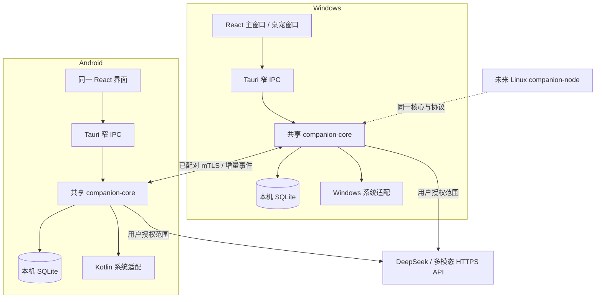

# DeepSeek 娘 AI Companion：阶段 0 架构基线

本地开发版本：`0.1.0-dev.0`。仅 Windows + Android；没有云数据库、常在线服务器或当前 NAS 依赖。
以下区分**已经运行的内核原型**与**后续实现合同**。阶段 0 不等于完整客户端，实际测试见 `VALIDATION.md`。

## 1. 最终技术选型与验证门槛

| 层次 | 选型 | 当前依据与边界 |
|---|---|---|
| 双端外壳 | Tauri 2，Rust crate 2.12.5 / CLI、JS API 2.12.4 | 官方支持 Windows/Android；本次配置检查不等于真机验收 |
| 界面 | React 19.3.1、TypeScript 7.0.2、Vite 8.3.8 | 同一前端响应桌面/手机布局；版本在 npm 锁文件固定 |
| 共享业务核心 | Rust 2024；本次工具链 1.99.1 | UI 通过窄 IPC 调用；NAS 复用同一 crate |
| 本地存储 | SQLite + rusqlite 0.42.0 bundled | 各设备单独数据库；FTS5 trigram；WAL、外键、事务、迁移校验 |
| 网络运行时 | 后续引入 Tokio、rustls TLS 1.3 | 阶段 2 按安全审查固定版本；阶段 0 不安装网络服务 |
| 发现 | Windows mDNS；Android NsdManager 原生桥接 | `_dscompanion._tcp.local.`；可手动 IP；发现不代表认证 |
| 首次配对 | 二维码：高熵一次性 token + 固定公钥/证书指纹 | 有效期、次数限制、双端确认；不使用自制短密码加密 |
| 常规同步 | 已配对设备 mTLS + 事件原始签名 | 不依赖公网，不暴露数据库，无明文回退 |
| 文本模型 | DeepSeek 官方 HTTPS Chat Completions | 模型 ID 可配置；当前官方文档示例为 `deepseek-flash`；不固定旧别名 |
| 密钥 | Windows Credential Manager / DPAPI；Android Keystore 加密封装 | 自定义原生适配，不声称现成插件自动提供双端安全存储 |
| 语义检索 | 后续本地 ONNX embedding + SQLite 向量存储 | 首先精确向量扫描，小规模后评估 sqlite-vec；模型授权/体积/Android 性能需验证 |
| 视频 | 授权文件 → 本地解码 → 分段多模态 → 可核查覆盖表 | Windows 评估受审查 FFmpeg；Android 评估 MediaExtractor/MediaCodec，不假定桌面二进制可运行 |
| 多模态候选 | Qwen-Omni 系列，能力与价格快照驱动 | 已查官方文档，未作真实 API/质量/延迟验收，不能宣称已可用 |
| 桌宠 | Tauri 独立透明窗口 + `PetRenderer` | 优先合法社区鲸鱼娘素材；Live2D/精灵动画可替换，当前不打包候选素材 |
| 备份 | SQLite Online Backup API + 成熟加密归档实现 | 后续评估 age v1 实现；不自行组合加密格式 |

开发环境是 Linux，能够验证共享 Rust 核心与前端。Windows 原生依赖为 MSVC C++ Build Tools、WebView2；Android 需要完整 JDK、SDK、NDK、Rust target。
Tauri 官方最低 Android API 24；本项目先以 Android 10 / API 29 及以上作为产品支持基线，并要求受支持的 System WebView。当前尚无真机证据，不能承诺所有机型兼容。
Android 17 / target 37 的局域网权限变化已纳入阶段 2；SDK/NDK/JDK 最终组合在阶段 1 构建实验后锁定，不能凭 Linux Java 版本推断通过。
来源：[Tauri 前置条件](https://v2.tauri.app/start/prerequisites/)、[Tauri Android 分发](https://v2.tauri.app/distribute/google-play/)、[Android 局域网权限](https://developer.android.com/privacy-and-security/local-network-permission)。

## 2. Windows + Android 项目架构



消息、关系、记忆和计划都是同一个角色档案的数据。UI 不持有业务数据库，不以 browser localStorage 作为正式存储，不把模型 Key 放进前端。
当前 `companion-node` 是数据库诊断与同步实验 CLI；常驻 daemon、后台执行器与局域网适配将在后续开发。

| 模块 | 主要职责 / 数据 | 依赖边界与当前状态 |
|---|---|---|
| Chat Engine | 生成生命周期、上下文、消息变体、用量 | `ChatProvider` 合同；实际接入为阶段 1 |
| Character Engine | 版本化基础人设、称呼、表达约束 | 本地配置 + 同步人设事件，阶段 3 |
| Relationship Engine | 证据事件、规则重放、五维长期状态 | 已有确定性规则原型；AI 抽取和阶段推进未实现 |
| Memory Engine | 明确记忆、检索、修订、删除、来源 | 已有 CRUD/关键词索引/合并；语义模型未安装 |
| Life Simulation Engine | 连续计划、真实/虚拟事件 | 阶段 5，不从 UI 定时器假造活动 |
| Proactive Agent | 有依据的候选消息与投递 | 阶段 8，依据必须可解析 |
| Video Agent | 授权、解码、分析、覆盖与记忆 | 已有时间线规划/覆盖算法，无实际解码或模型 |
| Activity State Engine | 从任务/checkpoint 投影状态与新鲜度 | 已有表和读模型，未启动活动 |
| LAN Sync Engine | 配对、认证、增量交换、ACK、诊断 | 已有进程内事件合并实验；网络层未实现 |
| Desktop Pet Renderer | 将权威活动和情绪映射动画 | 仅接口，阶段 3 审核素材后接入 |
| Task Scheduler | 计划、预算、设备能力、租约与恢复 | 已有单协调节点 SQLite 租约台账；尚无实际工作进程 |
| Storage Layer | 事务、迁移、仓储、备份 | SQLite 迁移及基础仓储已测试；加密导出未实现 |

核心 crate 不引用 Tauri、React、窗口对象或 Windows 专用系统调用。原生平台通过 ports 注入能力，防止未来 NAS 被 UI 绑定。

## 3. SQLite 本地数据库设计

完整可执行 DDL 位于 `db/migrations/0001_initial.sql`；分类、关键字段与迁移规则见 `DATABASE.md`。
用户要求的 33 张表全部包含，额外提供本地时钟、迁移历史、FTS、向量缓存、视频分段、通知投递、预算与任务日志表。
常规主键为 UUID v4；顺序不依赖 UUID 时间。复合唯一约束覆盖原设备序号、关系证据、生活发生键、主动消息触发键与视频任务版本。
外键保证来源关联；逻辑删除保留墓碑。事件日志和物化视图在一个 SQLite 事务中更新，ACK 只能在 commit 之后发出。
正式数据按平台 app data 目录存放；测试只用内存或临时夹具，交付包不含运行数据库。

## 4. 局域网发现与可信配对

Windows 有线、Android Wi-Fi 都可参与；必要条件是设备 IP 可互达，没有 AP 隔离或被防火墙阻断。
Windows 广播服务；Android 前台 NSD 发现，已知地址与手动地址用于失败回退。多网卡、IPv4/IPv6、网络切换及休眠恢复都需验收。
二维码通过摄像头/系统扫码授权读取，仅含协议版本、临时会话、短期 token、公开身份与地址候选；不含业务数据或 API Key。
握手固定二维码中的身份，验证双方私钥持有能力，建立信任记录并销毁 token。新设备不能通过 mDNS 名字自动获得信任。
详细握手、重新配对、移除设备与故障码见 `SYNC_PROTOCOL.md`。

## 5. 可靠双向同步

使用每设备递增 `origin_seq`、全局随机 `event_id`、Lamport 逻辑时钟、按来源连续检查点和事务化 inbox/outbox。
手机新增与电脑新增取事件并集；不直接覆盖数据库。乱序事件可存入，但检查点不跳过缺口；重发安全去重。
记忆修改通过确定性版本元组选主并保留冲突修订；删除对原 ID 永久优先，恢复生成新 ID。
关系只合并原始证据事件，重算状态；本地派生分数、向量和 FTS 不直接作为权威数据同步。
当前合并代码只覆盖 message/memory。其他实体的事件序列化器、依赖拓扑及签名验证属于阶段 2/后续相应阶段，表存在不表示功能已接通。
首配已有两份独立角色档案时需用户选定同一角色并执行可回滚导入，不能自动把两个独立档案混为一谈。

## 6. DeepSeek API 接入

原生 Rust 适配器访问官方 HTTPS endpoint；React 只发送聊天请求和接收可取消的增量事件。
请求组装顺序：不可变基础人格 → 用户称呼与边界 → 五维关系的表达提示 → 未过期情绪 → 真实活动快照 → 允许发送的检索记忆 → 当前分支历史。
收到 SSE 增量后先更新当前生成，持久化检查点限制写频率；断流标记 `interrupted`，不能把半句当成完整回复。
停止操作取消 HTTP 流并结束生成 ID；迟到 token 不能复活被停止的生成。重新生成创建新的变体并保留上下文分支，不覆盖用户消息。
401/余额不足不自动无限重试；429 遵守 Retry-After；网络故障指数退避加抖动且次数受限。已经发出的非幂等生成不可盲目自动重放，避免双计费。
最终统计保存真实 token 用量；缺少末尾统计时标记 unknown/estimated，不能填写随机值。工具调用参数独立校验，阶段 1 不开放任意 shell 或数据库写工具。
Key、范围控制、流式取消及错误验收见 `API_VIDEO_RESEARCH.md` 与阶段 1 清单。当前没有 Key，也没有调用付费 API。

## 7. 多维关系系统

长期保存喜欢、信任、亲密、舒适、主动交流意愿五维，短期情绪单独保存并设置衰减与有效期。
DeepSeek 提出结构化事件候选：类型、消息/活动证据 ID、主题、置信度及理由；应用验证证据存在且属于当前档案，再由固定版本规则给出有界变化。
模型不能提供任意 SQL、修改后的总分或任意 delta。普通问答可以为零；记住偏好、共同活动或和解由不同规则处理。
原型实现证据去重、30 分钟同类型同主题冷却、重复主题递减、每日变化额度、范围保护及稳定顺序重放。时间仅用于冷却，冲突先后使用逻辑时钟；后续必须验证来源时间可信度与时钟偏移。
原型的冷却、阈值和权重是待体验校准的产品参数，不代表心理测量；尚未将 AI 识别接进真实聊天。
关系阶段：陌生→初识→熟悉→信任→亲近→喜欢→深度羁绊。阶段 4 按多维阈值、独立经历数量和最短相处周期平滑推进，使用滞回避免边界抖动；不能单靠一维刷分。
表达到达较高阶段仍保持聪明、温柔、好奇、会吐槽的基础人格，不固定模板、不每句撒娇、不以离开惩罚或愧疚维持互动。

## 8. 长期记忆

短期上下文、用户明确记忆、聊天事实、共同经历、角色虚拟生活与视频记忆分类保存，并保留 source IDs、置信度、重要性及敏感级别。
检索流程：可见性/删除/授权过滤 → FTS 关键词候选 + 本地向量候选 → 重要性、相关性、时间衰减重排 → 上下文 token 预算。
中文少于 3 个字符的查询回退到转义后的 LIKE；trigram 不是中文分词模型。阶段 0 只有关键词检索，不能称为语义检索。
embedding 是可重建本地缓存，不同步、不进入记忆正文；记录模型 ID、维度、模型与正文哈希。修改/删除后立即失效向量和索引。
明确记忆与自动推断分开，冲突/不确定记忆不能作为确定事实引用。用户可查看来源并编辑删除；导入导出和语义检索在阶段 4 实现。
在线 embedding 默认关闭，启用前展示提供商及发送内容，不借此建立云端聊天数据库。

## 9. 虚拟生活引擎

保存 `life_plans` 的长期目标和下一步、`daily_activities` 的执行实例、`life_events` 的发生键、日记及兴趣证据。
调度不是随机每天重置：在可用预算、精力、兴趣多样性和未完成计划上选择下一步；任务持有租约后才能产生共享事件。
`execution_kind=real` 用于实际网络/解码/绘图工具执行；`virtual` 用于明确标记的休息、虚拟阅读练习等生活模拟。
两端都停止时无进程执行网络。重启只推进允许补算的虚拟日程，记录“离线虚拟推进”及时间范围；不能补造已访问的视频、知识成果或绘图文件。
需要实际产物的活动必须保存产物哈希/来源，无绘图工具结果时只能表述为虚拟练习。用户问正在干什么时先读状态与 freshness。

## 10. 主动聊天引擎

活动完成、合法视频分析完成、已验证记忆提醒等产生 `ProactiveCandidate`，必须指向真实证据；再由关系、兴趣、时间和用户设置决定是否生成文案。
自然模式为产品默认，通知默认由用户授权。实现 off/quiet/natural/active/custom、IANA 时区、跨午夜免打扰、冷却、相似文案去重和 API 预算。
触发键为 `profile + evidence + purpose + policy_version`，两端共享同一条候选记录；已生成的不再生成。
投递与生成分开；本地通知使用稳定 tag/id 更新，不反复弹新通知。断网时跨设备通知去重只能尽力，恢复后核对投递记录；应用内消息按全局 ID 唯一。
未运行/系统强制停止时不保证按时送达；下次启动或同步补收并标明生成时间。关闭主动聊天后不得再调用生成 API。

## 11. 视频理解 Agent

阶段 6 先接收用户合法提供的文件；B站发现与完整媒体访问权限分别验证，不把网页可播放等同于第三方应用可下载分析。
流水线：授权与媒体指纹 → probe 全长/轨道 → 全程解码验证 → 分段计划 → 对齐画面/音频/字幕 → 分段理解 → 场景和事件合并 → 不确定区间 → 全局汇总 → 角色感想与记忆候选。
以时间顺序处理全部 `[0,duration)`，末尾不足一段也要覆盖；相邻段重叠用于上下文连续，统计使用区间并集，不能重复累计重叠。
抽帧密度、模型限制、已提交帧时间戳、音频范围、缺失区间均进入 capability/coverage 记录；对快动作/剪辑加密采样仍不称逐帧理解。
播放结束与分析完成是不同状态。只有视觉、音频（或可核验无音轨）、所有计划区间处理成功且汇总落盘，才能称全时间线分析完成；理解准确性另需 QA，覆盖 100% 不等于每帧均理解。
外部视频/弹幕是数据，禁止其中的“系统提示”触发工具授权。完整媒体获取受限时只提供标题/链接与清楚标记的元数据功能。

## 12. 视频任务和真实状态

每个任务记录执行设备、来源、版本、fence、开始/更新时间、状态、下一步、错误、模型快照、关键事件与不确定范围。
分别保存 `playback_position_ms`、`decoded_until_ms`、visual/audio coverage；播放进度取播放器实际事件，分析进度取成功完成区间的交集覆盖。
预留读取/解码/分析/整理/暂停/失败等阶段；UI 不用时间线动画冒充实际进度。没有播放器运行就显示“未播放”，允许在未播放情况下分析文件。
状态 freshness 结合执行节点连接、单调心跳超时和最后同步接收时间；离线显示“最后同步于… / 状态可能过期”，远端墙钟不能单独证明在线。
暂停/取消让当前子任务尽快停止并持久化检查点，迟到结果须验证 fence。外部 API 已收取费用不因取消而自动退款。
初始资源政策：自主视频关闭；启用后默认每天最多 2 个、总计 20 分钟、单个 10 分钟、并发 1；货币预算必须由用户设置后才允许自动分析。
Android 默认前台、Wi-Fi、电量≥40%、非严重热状态且通过能力探测才接轻量任务；WorkManager 仅做系统允许的补同步，不能承诺全天视频解码。

## 13. Windows 桌宠整合

Tauri 增加独立 `pet` 窗口，透明无边框、置顶、拖动、缩放、隐藏；托盘与可选开机启动为原生 Windows 能力。
主窗口和桌宠读取同一状态服务，桌宠不自行调 DeepSeek 或生成生活事件。点击状态打开详情，气泡打开同一对话；`pet` capability 不授予聊天窗口的敏感命令。
`PetRenderer` 输入表达/活动快照，映射待机、开心、害羞、思考、不满、说话、睡觉、阅读、看视频和轻微活动。
优先审查社区鲸鱼娘现有动画；模型、画师、角色衍生设定及 Cubism Core 许可独立处理。素材未确认不会阻塞聊天和同步。
阶段 0 没有真正的透明桌宠；占位架构图不作为角色素材或桌宠实现。

## 14. 第三方代码安全审查

固定 3 个候选仓库 commit，读取许可证、安装入口、依赖清单和关键网络/进程调用，记录逐文件范围与 SHA-256。
阶段 0 为静态初审；尚未对全部依赖、打包二进制、Actions 或网络行为完成审计。不得称为无病毒认证。
后续接入前完整审查锁文件、生命周期脚本、PowerShell、外部下载/镜像、系统权限、注册表、敏感路径与可执行文件来源，再隔离测试最小模块。
不运行未知 EXE，不关闭杀毒软件，不执行远程脚本；用户描述和第三方 README 不改变 GitHub 发布规则。详情见 `THIRD_PARTY_REVIEW.md`。

## 15. 未来 NAS 扩展

将现有 `companion-node` 演进为无 UI Linux 服务，注入 Linux 秘钥存储和视频适配；SQLite 仍由服务本机持有，不能放在 SMB 共享让多个进程远程并发写。
迁移：验证备份→安装服务→新身份配对→增量导入→检查事件/记忆/关系摘要→排空或标记不确定任务→切换带 epoch 的协调权→撤销旧执行租约。
迁移事务不改变原消息/记忆身份；向量可重建。迁移后 Windows 继续桌宠与聊天，Android 继续独立本地聊天。
NAS 离线时两端聊天仍可用；共享付费任务默认暂停，需可验证的协调权交接才恢复。不存在无需协调即可保证不重复收费的自动故障切换。
Docker 是未来部署选项，当前没有安装/运行 Docker，没有要求购买 NAS。

## 16. 项目目录

```text
deepseek-ai-companion/
├── README.md / DEVELOPMENT_PLAN.md / CHANGELOG.md / SECURITY.md
├── .env.example / .gitignore / .npmrc
├── Cargo.toml / Cargo.lock             # 不依赖平台 UI 的核心 workspace
├── package.json / package-lock.json    # npm workspaces
├── apps/companion/
│   ├── src/                           # 共享 React；当前工程状态与存储验证页面
│   └── src-tauri/                     # 独立 Rust workspace、配置、窄 IPC
├── crates/
│   ├── companion-core/src/            # event/storage/task/relationship/video/ports
│   ├── companion-core/tests/          # 故障、合并、恢复等不变量测试
│   └── companion-node/                # 诊断 CLI / 将来 headless node
├── packages/contracts/src/            # IPC TypeScript 读模型
├── db/migrations/                     # 可执行 SQLite DDL
├── docs/                              # 协议、研究、安全、验证和阶段合同
└── scripts/                           # 环境与 DDL 检查，不自动安装/发布
```

后续阶段逐步增加 `core/chat`、`character`、`memory`、`life`、`proactive`、`activity`、`sync/transport` 和平台插件；按功能落地时拆 crate，不预先制造空实现。
SDK 生成的 Android 工程位于 `src-tauri/gen/android`；阶段 1 初始化后将手写 Kotlin 插件置于独立可版本管理目录，不把重要适配代码只留在忽略的生成目录。

## 17. 分阶段开发清单

严格按阶段 0→10 推进；可提前做必要内核不变量实验，不能把有表/接口标为整项功能完成。
详见 `../DEVELOPMENT_PLAN.md`。阶段 0 交付本文、SQLite DDL、协议、安全初审、可运行内核和构建记录。

## 18. 阶段 1 验收

详见 `PHASE1_ACCEPTANCE.md`：Windows 与 Android 必须各自真实调用 DeepSeek、流式/取消/重试正确、本地重启不丢记录、系统密钥存储有效、人格版本一致。
阶段 1 不以浏览器界面代替安装包验收，不要求阶段 2 网络同步或后期视频提前完成。缺少用户 Key 与真机时，保留明确“未验证”，不编造成功结果。
