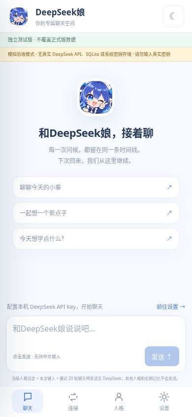
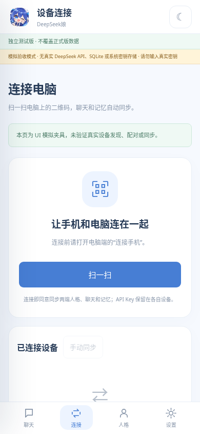

# 手机界面检查证据

以下是 390×844 浏览器 UI 夹具截图，页面上保留模拟横幅；没有真实通知栏或相机硬件，不作为手机实机验收。

`signing-presence.json` 仅含 main CI 可用配置的四个存在布尔值；GitHub Secrets 元数据接口本身返回 403，不据此判断密钥丢失。`local-signing-continuity.json` 来自官方 apksigner 对真实已发布 APK 的检查及已有本地构建证书对比，仅含公开证书与文件摘要、匹配状态，没有密码、私钥或 Base64。两个证书不匹配，本次未使用本地开发签名替换现有 APK。

全部结果及尚未执行的实机范围见 [手机修订报告](../PHASE2_MOBILE_QR_REPORT.md)。

`ci-results.json` 为 GitHub API 实际返回的同源作业与附件状态。附件记录中的 digest/bytes 是 Actions ZIP 的摘要与大小，安装包本身的 SHA256SUMS 保存在各构建附件中，不能混用。原 `.test` 未签名候选不可安装；这不是新版 APK 的公开发布证明。
