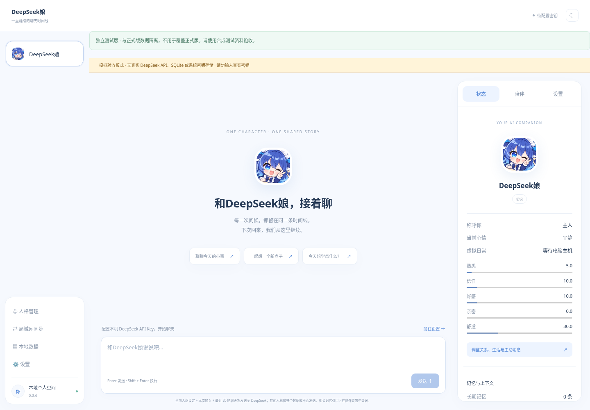
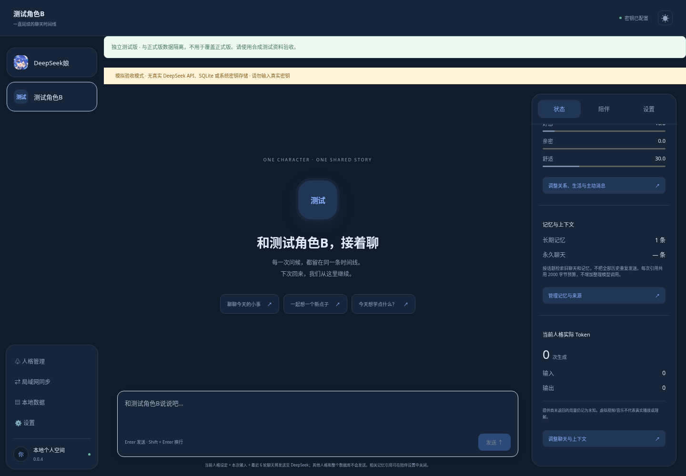

# 阶段3追加修复本地证据

本目录仅含合成测试日志、明确标记的UI夹具截图与结果；无用户数据库/备份、真实Key、Keystore、密码、私钥、Token或签名bundle。基线为e53b5971，最终安装包以同源CI/候选BUILD-RESULTS的完整提交为准。版本选择待确认，公开旧v3包不包含这些追加改动。

| 检查 | 结果 | 实际范围 |
|---|---|---|
| Rust workspace | 115 passed / 0 failed / 0 ignored | 真实Rust/SQLite；15聊天、47核心、原21不变量、3密钥抽象、29同步 |
| 旧签名队列回归 | 修复前失败，修复后通过 | 两个真实回环TLS服务，旧列形状签名不改；不是家庭路由器 |
| Clippy | warnings-as-errors通过 | 共享Rust workspace与测试 |
| Python / Node | 24 / 5通过 | 版本、发布门禁、扫码模型等策略夹具 |
| UI普通 / 独立测试 | 各28通过 | 明确Mock内存桥接，实际浏览器布局/相机生命周期，不冒充原生TLS |
| DDL | 外键/完整性/中文FTS及增改删除通过 | 独立Python SQLite内存库，真实文件升级/备份回滚另由Rust验证 |
| Android native Rust | aarch64检查通过 | 真JDK/SDK/NDK环境的native crate编译，不等于完整APK构建或手机运行 |
| 品牌 | 原图SHA及69项派生通过 | 没有重新设计素材 |

`legacy-sync-before-fix.txt` 的一个红色测试是特意保留的缺陷复现，不代表最终115项失败。该复现与修复发生在更新候选版本号前，日志版本仍为0.0.3；`followup-rust-final.txt` 为候选0.0.4最终全量结果。UI普通检查同样在版本改号前通过，随后由同源CI重新执行两组。

无主人真实设备、API Key或数据库访问通道。Windows完整构建/签后中文安装启动、Android全APK和官方签名验证看同源Hosted结果；家庭网线+Wi-Fi、相机与覆盖升级、真实DeepSeek/Token节省不能由本目录宣称通过。见 [实机清单](../PHASE3_FOLLOWUP_ACCEPTANCE.md)。
