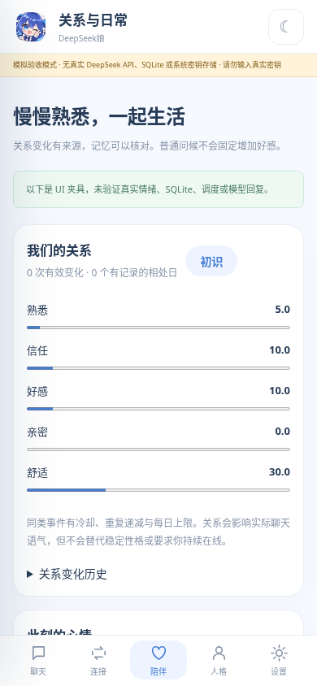
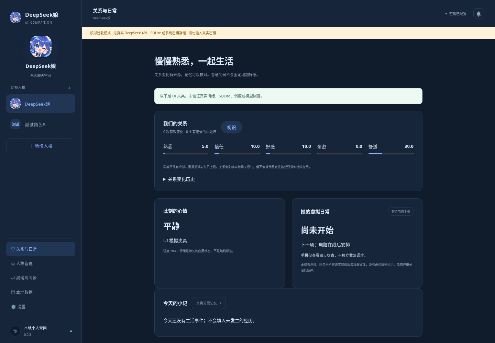

# 阶段3提交前本地验证

以下全部使用合成资料，不包含用户聊天库、Keystore、密码或API Key。

- priority-pairing：优先缺陷修复的81项Rust和独立SQLite，当时先通过后才开发阶段3。
- local-rust：后续完整103项，0失败/忽略；Clippy通过，Python23、Node5。
- local-schema：原33张要求表仍存在，加上生产迁移，13个companion/身份相关表检查、外键/中文搜索/完整性通过。
- local-android-rust-check：最终Android native Rust交叉检查；不代表完整APK或手机运行。
- local-ui/local-ui-isolated：两组各26项明确浏览器夹具，不是系统凭据/真实API/相机驱动/TLS验收。PNG只作桌面/手机布局预览，数据是夹具。
- baseline-signing与apksigner文件：实际已发布v1/v2 APK的官方验签和公开证书，不含私钥。Secrets元数据403不能判断缺失。

这些记录来自提交前工作区；最终同源GitHub CI和签名发布重新执行检查，精确SHA、两组UI/原生构建及下载结果见v0.0.3 Release BUILD-RESULTS.json与完整日志。未执行真实API、家庭网络或用户旧数据库验收。LinuxGUI缺GTK/gobject2开发包，未声称通过。

